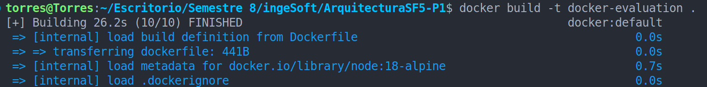
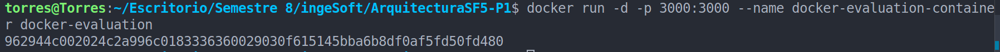
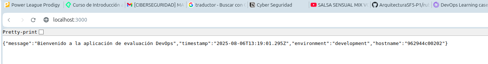

# ArquitecturaSFV-P1

# Evaluación Práctica - Ingeniería de Software V

## Información del Estudiante

- **Nombre:** Alejandro Torres Soto
- **Código:** A00394983
- **Fecha:** 06/Agosto/2025

## Resumen de la Solución

[Breve descripción de tu implementación]

## Dockerfile

Primero llamé la versión 18-alpine de node

Luego, cree el directorio de trabajo

Luego copié el package.json y los demás archivos del proyecto

Corro el comando `npm install`

Creó la imagen de Docker

Expongo la app en el puerto 3000 del contenedor y a su vez en el puerto 3000 de mi máquina.

Finalmente, con el npm start dentro del dockerfile y el comando anterior la app debería estar corriendo en el contenedor y estar expuesto también el puerto 3000 de mi maquina

## Script de Automatización

[Describe cómo funciona tu script y las funcionalidades implementadas]

## Principios DevOps Aplicados

1. [Principio 1]
2. [Principio 2]
3. [Principio 3]

## Captura de Pantalla

[Incluye al menos una captura de pantalla que muestre tu aplicación funcionando en el contenedor]

## Mejoras Futuras

[Describe al menos 3 mejoras que podrían implementarse en el futuro]

## Instrucciones para Ejecutar

[Instrucciones paso a paso para ejecutar tu solución]
