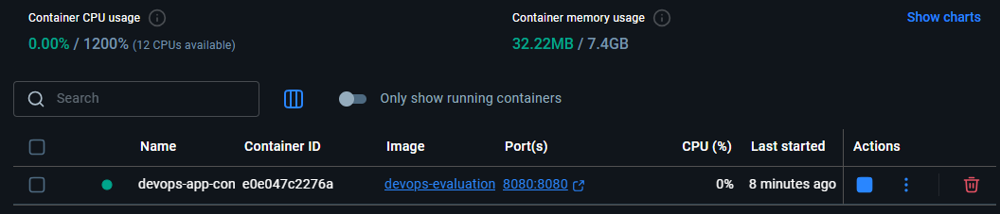

# ArquitecturaSFV-P1

# Evaluación Práctica - Ingeniería de Software V

## Información del Estudiante

- **Nombre: Juan Manuel Marín Angarita**
- **Código: A00382037**
- **Fecha: 06/08/2025**

## Resumen de la Solución

Esta solución implementa una app Node contenerizada usando Docker, junto con un script realizado en PowerShell que realiza todos los comandos relacionados con el ciclo de vida del despliegue. La aplicación es una API REST sencilla que proporciona información del sistema y un endpoint de health check, que busca demostrar conceptos fundamentales de DevOps y contenerización.

## Dockerfile

El Dockerfile usa los siguientes parámetros:

- **Imagen base**: `node:22.14.0` - Versión LTS estable instalada
- **Directorio de trabajo**: `/` - Es la ruta base del proyecto
- **Optimización de layers**: Se copian primero los archivos `package*.json` para aprovechar el cache de Docker durante `npm install`
- **Puerto expuesto**: 3000 - Puerto por defecto del proyecto
- **Comando de inicio**: `npm start` - Utiliza el script definido en package.json

```dockerfile
FROM node:22.14.0
WORKDIR /
COPY package*.json ./
RUN npm install
COPY . .
EXPOSE 3000
CMD ["npm", "start"]
```

## Script de Automatización

El script de PowerShell (`script.ps1`) automatiza completamente el proceso de despliegue mediante estos pasos:

1. **Verificación de Docker**: Comprueba que Docker esté instalado y ejecutándose
2. **Limpieza de recursos**: Elimina contenedores e imágenes previas para evitar conflictos
3. **Construcción automática**: Ejecuta `docker build` con manejo de errores
4. **Despliegue del contenedor**: Inicia el contenedor con las variables de entorno requeridas:
   - `PORT=8080` (interno del contenedor)
   - `NODE_ENV=production`
   - Mapeo de puertos: `8080:8080`
5. **Verificación del servicio**: Realiza peticiones HTTP para confirmar que la aplicación responde
6. **Reporte de estado**: Proporciona feedback detallado del éxito o fallo de cada operación

## Principios DevOps Aplicados

1. **Automatización**: El script elimina la intervención manual en el proceso de despliegue, mejorando la eficiencia.
2. **Infraestructura como Código (IaC)**: El Dockerfile define la infraestructura del contenedor de manera declarativa y versionable.
3. **Integración Continua**: La solución facilita la integración de cambios mediante la automatización de construcción y despliegue de contenedores.
4. **Monitoreo y Observabilidad**: Implementación de health checks y logging para facilitar el monitoreo del estado de la aplicación.

## Captura de Pantalla




## Mejoras Futuras

- Hacer el script más parametrizable con variables para permitir la personalización del despliegue.
- Utilizar archivos de configuración externos.

## Instrucciones para Ejecutar

1. Clonar el repositorio
2. Abrir powershell
3. Ejecutar Docker
4. Ejecutar el script con el comando:

```powershell
.\script.ps1
```

5. Comprobar en consola que la aplicación se desplegó correctamente
