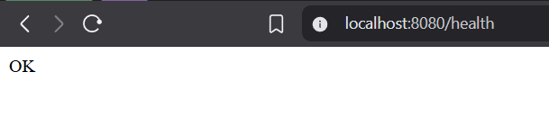

# ArquitecturaSFV-P1

# Evaluación Práctica - Ingeniería de Software V

## Información del Estudiante
- **Nombre:Sebastian Erazo Ochoa**
- **Código:A00400086**
- **Fecha:06/08/2025**

## Resumen de la Solución
Esta solución implementa una aplicación en Node.js utilizando el framework Express. La aplicación ha sido contenerizada con Docker y su despliegue ha sido automatizado mediante un script en Bash.

## Dockerfile

- Se usó la imagen oficial `node:18` como base por su estabilidad.
- Se estableció el directorio de trabajo `/app` para mantener la estructura organizada.
- Se copiaron los archivos `package.json` y `package-lock.json` para instalar solo las dependencias necesarias.
- Se expuso el puerto `8080`.
- Se configuraron las variables de entorno `PORT` y `NODE_ENV`.

## Script de Automatización

El script automatiza el despliegue de la aplicación:

1. Verifica si Docker está instalado.
2. Construye la imagen usando el `Dockerfile`.
3. Elimina cualquier contenedor anterior que tenga el mismo nombre.
4. Ejecuta el contenedor con las variables de entorno `PORT=8080` y `NODE_ENV=production`.
5. Realiza una prueba HTTP a la ruta `/health` usando `curl` para verificar si el servicio está funcionando.
6. Muestra un resumen del estado del contenedor usando `docker ps`.

## Principios DevOps Aplicados
1. **Automatización del Despliegue:** Se implementó un script en Bash que automatiza la construcción de la imagen Docker, la ejecución del contenedor y la validación del servicio, reduciendo tareas manuales y mejorando la eficiencia.
2. **Contenerización:** Uso de Docker para encapsular el entorno de ejecución de la aplicación, garantizando portabilidad y consistencia.
3. **Retroalimentación continua:** Se implementa un endpoint `/health` que permite verificar la disponibilidad del servicio automáticamente.

## Captura de Pantalla

## Mejoras Futuras
Pienso que como mejoras futuras, se puede integrar un pipeline con GitHub Actions para automatizar el despliegue de la imagen, agregar soporte para archivos `.env` que permitan una gestión mejor de configuraciones, implementar pruebas automatizadas y utilizar Docker Compose para permitir el despliegue de múltiples servicios como bases de datos.

## Instrucciones para Ejecutar
1. Clonar el repositorio
    git clone https://github.com/tu-usuario/ArquitecturaSFV-P1.git
    cd ArquitecturaSFV-P1
2. Dar permisos al script
    chmod +x start.sh
3. Ejecutar el script
    ./start.sh
4. Verificar
    Página principal: http://localhost:8080/
    Endpoint de estado: http://localhost:8080/health
