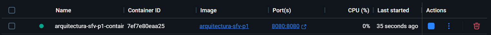

# ArquitecturaSFV-P1

# Evaluación Práctica - Ingeniería de Software V

## Información del Estudiante
- **Nombre:** Silem Nabib Villa Contreras
- **Código:** A00395548
- **Fecha:** 08/06/2025

## Resumen de la Solución
Se contenerizo una app de Node.js usando docker, el proceso se automatizo mediante un script de PowerShell, el script se encarga de la contenerización, ejecución y comprueba que el contenedor se este ejecutando de forma adecuada.

## Dockerfile
Para la Dockerfile se utilizó `node:18-alpine` para optimizar el peso y tiempo de construcción de la imagen por ser una imagen ligera. Se copian primero los archivos de dependencias para aprovechar el cache de Docker y acelerar builds futuros. Solo se instalan dependencias de producción. Se expone el puerto 8080 y se definen variables de entorno.

## Script de Automatización
El script `deploy.ps1` automatiza todo el flujo: verifica que docker este instalado Docker, construye la imagen, ejecuta el contenedor con las variables requeridas, realiza una prueba HTTP y muestra un resumen del estado. Incluye manejo de errores y mensajes claros.

## Principios DevOps Aplicados
1. **Automatización**.
2. Contenerización para portabilidad y consistencia.
3. Documentación clara y reproducibilidad del entorno.

## Captura de Pantalla

## Mejoras Futuras
1. Integrar CI/CD para despliegue continuo. 
2. Añadir tests automáticos más completos.
3. Soportar múltiples entornos (dev, staging, prod) con archivos de configuración.

## Instrucciones para Ejecutar
1. Instala Docker en tu sistema.
2. Abre PowerShell en la carpeta del proyecto.
3. Ejecuta: `./deploy.ps1`
4. Accede a http://localhost:8080 para ver la app funcionando.
