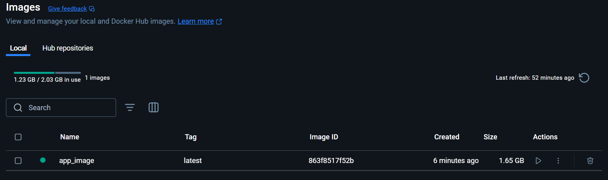
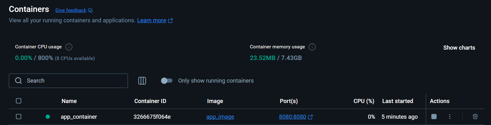
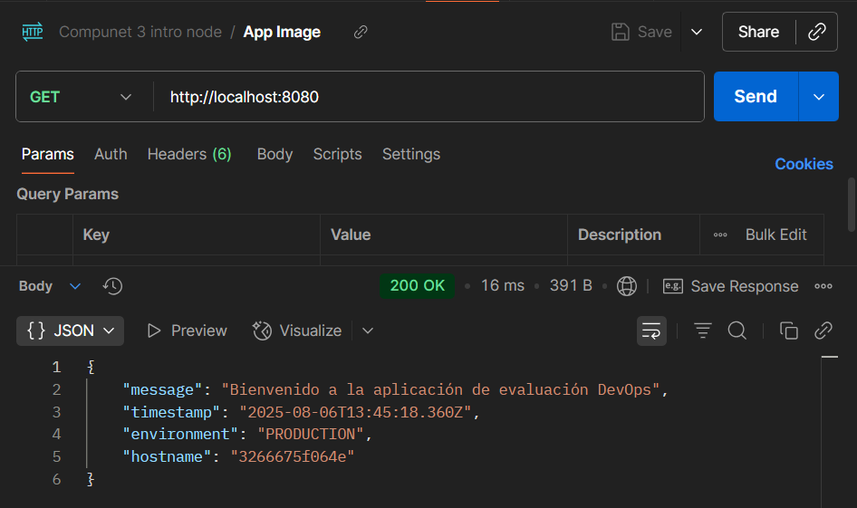

# ArquitecturaSFV-P1

# Evaluación Práctica - Ingeniería de Software V

## Información del Estudiante
- **Nombre:** Cristian Eduardo Botina Carpio
- **Código:** A00395008
- **Fecha:** 6 de agosto de 2025

## Resumen de la Solución
Se crea un archivo Dockerfile que contiene la información para crear la imagen, con los comandos build y run se crea la imagen y despliega el contenedor, respectivamente.

## Dockerfile
Se usa la imagen oficial de node como base, y se establece que las operaciones se realizarán desde el directorio app. Luego se instalan las dependencias, copiando el archivo package.json, crea la carpeta de módulos y ejecuta npm install. Finalmente, da los permisos necesarios y expone el puerto 3000, para iniciar la aplicación.

## Script de Automatización
El script de powershell usa Get-Command para verificar si docker está instalado y activo, escribiendo un mensaje de error si no lo está. En caso de que el contenedor se haya desplegado anteriormente, se borra para evitar conflictos, con esto se puede construir la imagen y desplegar el contenedor usando docker build y run. Se espera 1 seg antes de probar con una request y verificar que, efectivamente el servicio está activo y el entorno es el adecuado.

## Principios DevOps Aplicados
1. **Automatización**: con el script es posible configurar y desplegar el proyecto rápidamente sin intervención manual
2. **Containerización**: uso de Docker para crear un entorno consistente e inmutable que garantiza el mismo comportamiento en diferentes sistemas
3. **Infrastructure as Code**: el Dockerfile define la infraestructura de manera declarativa y versionable, permitiendo reproducir el entorno de manera consistente

## Captura de Pantalla

Imagen y contenedor





Solicitud exitosa



## Mejoras Futuras
1. **Implementación de Pipeline**: Integrar GitHub Actions o Jenkins para automatizar el proceso de construcción, pruebas y despliegue continuo
2. **Pruebas Automatizadas**: Implementar pruebas unitarias, de integración y end-to-end para garantizar la calidad del código
3. **Uso de Docker Compose**: Implementar Docker Compose para manejar múltiples servicios como base de datos backend o frontend en caso de que el proyecto requiera más componentes en el futuro
4. **Gestión de Secretos**: Usar un sistema seguro para manejar variables de entorno sensibles

## Instrucciones para Ejecutar

### Requisitos
- Docker instalado y funcionando en el sistema
- PowerShell

### Ejecución usando el script
1. Ejecutar el script de automatización:
   ```powershell
   .\init_container.ps1
   ```
2. El script verificará que Docker esté instalado, eliminará contenedores previos (si existen), construirá la imagen Docker y desplegará el contenedor para hacer una prueba de conectividad