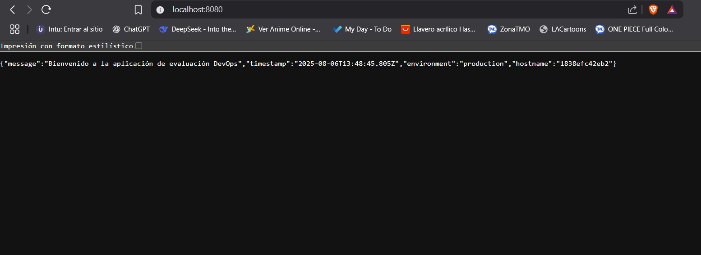

# ArquitecturaSFV-P1

# Evaluación Práctica - Ingeniería de Software V

## Información del Estudiante
- **Nombre: Andrés Cabezas**
- **Código: A00394772**
- **Fecha: 06/08/2025**

## Resumen de la Solución
Se desarrolló una aplicación sencilla en Node.js con Express que expone dos endpoints:
- `/` → Devuelve un mensaje de bienvenida, la fecha/hora, el entorno y el hostname del contenedor.
- `/health` → Devuelve `OK` para verificar el estado del servicio.

La aplicación fue contenerizada con Docker y se creó un script en Bash que automatiza la construcción, ejecución y verificación del contenedor.

## Dockerfile
- **Imagen base:** `node:18-alpine` por ser ligera y segura, reduciendo el tamaño final de la imagen.
- **WORKDIR:** `/app` para mantener un entorno de trabajo ordenado dentro del contenedor.
- **Copia de dependencias primero:** `COPY package.json` y `npm install --production` para aprovechar la caché de Docker y reducir tiempo de build.
- **Copiar el resto de archivos:** `COPY . .` para incluir el código fuente.
- **Puerto expuesto:** `EXPOSE 8080` para mantener coherencia con el script y la variable de entorno `PORT`.
- **CMD:** `node app.js` para iniciar la aplicación.

## Script de Automatización
El script realiza:
1. Construcción automática de la imagen (`docker build`).
2. Ejecución del contenedor mapeando el puerto 8080 y estableciendo variables de entorno (`PORT=8080`, `NODE_ENV=production`).
3. Espera breve (sleep 3) para que la aplicación arranque.
4. Prueba de disponibilidad usando `curl` sobre el endpoint `/health`.
5. Mensaje en consola indicando si el servicio respondió correctamente.

## Principios DevOps Aplicados
1. **Automatización de procesos:** Uso de script Bash para evitar pasos manuales en la construcción y despliegue.
2. **Consistencia entre entornos:** Contenerización con Docker para que la aplicación se ejecute igual en cualquier entorno.
3. **Monitoreo básico:** Endpoint `/health` que permite verificar rápidamente si el servicio está en funcionamiento.

## Captura de Pantalla

## Mejoras Futuras
1. Integrar un pipeline CI/CD con GitHub Actions para build y despliegue automático.
2. Implementar pruebas unitarias y de integración para ejecutar antes del build.
3. Configurar manejo de variables de entorno mediante un archivo `.env` para mayor seguridad y flexibilidad.

## Instrucciones para Ejecutar
1. Clonar este repositorio:
   git clone <https://github.com/andrescabezas26/ArquitecturaSFV-P1.git>
2. Asegurarse de tener Docker instalado

    docker --version
3. Dar permisos de ejecución al script

    chmod +x script.sh
4. Ejecutar el script

    ./script.sh
5. Abrir el navegador y revisar la app

    localhost:8080

    localhost:8080/health
