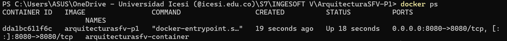

# ArquitecturaSFV-P1

# Evaluación Práctica - Ingeniería de Software V

## Información del Estudiante
- **Nombre:** Deiner Julian Motta Almario
- **Código:** A00400438
- **Fecha:** 06/08/2025

## Resumen de la Solución
La solución implementa la contenerización de una aplicación Node.js mediante Docker y un script automatizado para construir y ejecutar el contenedor.

## Dockerfile
Se utilizó una imagen base ligera (`node:20-alpine`), se estableció el directorio de trabajo, se instalaron las dependencias en modo producción y se expuso el puerto 8080. Finalmente, se definió el comando de inicio con `node app.js`.

## Script de Automatización
El script script.ps1 realiza lo siguiente:
- Verifica si Docker está instalado utilizando Get-Command.
- Construye la imagen de Docker con docker build.
- Elimina cualquier contenedor previo con el mismo nombre usando docker rm -f.
- Ejecuta el contenedor configurando las variables de entorno PORT=8080 y NODE_ENV=production mediante docker run.
- Verifica si la aplicación responde correctamente con Invoke-WebRequest y muestra un mensaje según el resultado.

## Principios DevOps Aplicados
1. **Automatización:** Creación de script para simplificar la ejecución.
2. **Entrega continua:** Uso de contenedores para despliegue consistente.
3. **Infraestructura como código:** Definición de la aplicación en un Dockerfile.

## Captura de Pantalla


## Mejoras Futuras
1. Integración de CI/CD para construcción automática de la imagen.
2. Uso de variables de entorno configurables desde un archivo `.env`.
3. Publicación de la imagen en Docker Hub para facilitar el despliegue.

## Instrucciones para Ejecutar
1. Clonar el repositorio:
      ```bash
   git clone https://github.com/Julianmotta07/ArquitecturaSFV-P1
   cd ArquitecturaSFV-P1
3. Abrir PowerShell en la carpeta del proyecto.
4. Ejecutar el script de automatización:
   ```bash
    .\script.ps1
5. Si todo funciona correctamente, abre un navegador y coloca:
  ```bash
    http://localhost:8080
