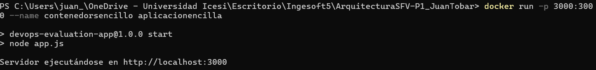
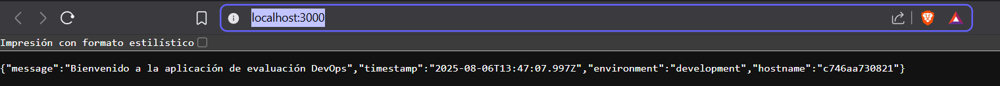

# ArquitecturaSFV-P1

# Evaluación Práctica - Ingeniería de Software V

## Información del Estudiante
- **Nombre:Juan Camilo Tobar Morales**
- **Código:A00399905**
- **Fecha:6 de agosto de 2025**

## Resumen de la Solución
Crear una imagen de docker para la aplicación node.js a partir de una base. Se configuro el docketfile para copiar dependencia, instalar los paquetes necesarios y copiar el código de la aplicación.

## Dockerfile
Se creo el archivo DockerFile para poder contruir la imagen que luego ira al contenedor, en el archivo se puso una imagen base funcional para node.js. Para mantener el proyecto ordenado se uso tambien un directorio de trabajo donde se ejecutaran los comandos y no desde el directorio raiz, se copian los archivos del json al contenedor con el comando COPY, luego se ejecuta el npm install dentro del contenedor. Se pone además el puerto donde funciona la applicación que es en el 3000 y se pone que comando se debe ejecutar que es el npm start.

## Script de Automatización
[Describe cómo funciona tu script y las funcionalidades implementadas]

## Principios DevOps Aplicados
1. Mejora continua: El utilizar herramientas como docker permite la facilidad de desarrollo y entrega del proyecto. Lo que reduce costos y puede mejorar la experiencia del cliente.
2. Integración y entrega continua: Utilizar herramientas como docker facilita y automatiza entornos de desarrollos ya que encapsula todas las herramientas necesarias en un proyecto.
3.  Mejora de procesos: El utilizar este tipo de herramientas pueden ayudar a que los productos sean mas escalables a futuro lo que permite integraciones y mejora de procesos rapidos y funcionales.

## Captura de Pantalla

## Mejoras Futuras
1. Automatización de las imagenes y contenedor.

2. Organización de archivos mejor y no todo en la carpeta raiz.

3. Ejecución de comandos mas automaticamente.

## Instrucciones para Ejecutar
Clonar repositorio

Constuir la imagen

Ejecutar el contenedor

Verificar la aplicación