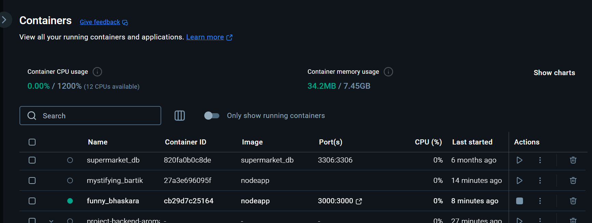
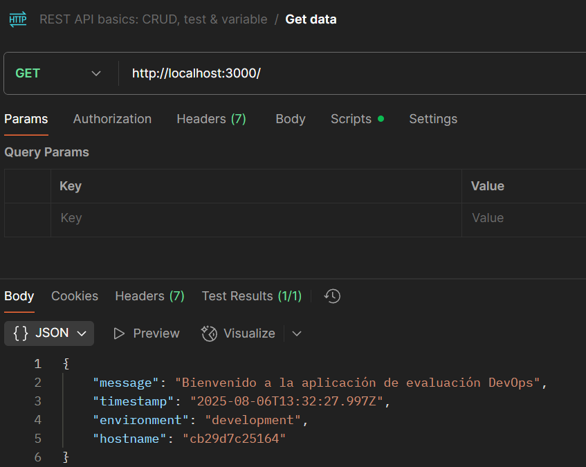

# ArquitecturaSFV-P1

# Evaluación Práctica - Ingeniería de Software V

## Información del Estudiante
- **Nombre: Nicolás Cuéllar Molina**
- **Código: A00394970**
- **Fecha: 6-Agosto/2025**

## Resumen de la Solución
Creo un archivo Dockerfile para crear el contenedor de nuestra aplicación, en este caso la imagen que se necesita es node con la versión 18. En el contenedor la carpeta de trabajo será /app, Copiamos todo el archivo de package.json que contiene nuestras dependencias, ejecutamos el npm install para instalar las dependencias, copiamos el resto de archivos y exponemos nuestro puerto. Finalmente se corre la aplicación.

## Dockerfile

La versión de node tomada por ser la usada en el app.js
Para el CMD se observó que en el package.json el script para ejecutar la app era "start"

## Script de Automatización
[Describe cómo funciona tu script y las funcionalidades implementadas]

## Principios DevOps Aplicados
1. Automatización
2. Mejora Continua
3. Siempre creando con el objetivo en mente

## Captura de Pantalla

## Mejoras Futuras

- Crear el script de Automatización
- Agilizar el proceso de build, ya que la versión resultó muy pesada
- Investigar de mejoras en el proceso de container

## Instrucciones para Ejecutar

Primer se construye la aplicación con:
docker build -t nodeapp .

Luego, se ejecuta la aplicación con:
docker run -p 3000:3000 nodeapp
