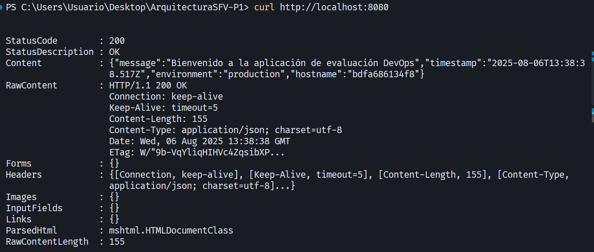

# ArquitecturaSFV-P1

# Evaluación Práctica - Ingeniería de Software V

## Información del Estudiante

- **Nombre: Maria Alejandra Mantilla Coral**
- **Código: A00395792**
- **Fecha: 6/08/2025**

## Resumen de la Solución

Este proyecto consiste en contenerizar una aplicación Node.js mediante Docker y automatizar su despliegue con un script en Bash. La solución permite construir la imagen, ejecutar el contenedor y verificar automáticamente que el servicio está funcionando, aplicando principios de DevOps como automatización, estandarización y reproducibilidad de entornos.

## Dockerfile

Para la contenerización se creó un Dockerfile optimizado que sigue estas decisiones técnicas:

1. **Imagen base ligera (`node:lts-alpine`):** Utilizada para reducir el tamaño de la imagen y agilizar tiempos de construcción.
2. **COPY package*.json ./ :** Permite copiar tanto `package.json` como `package-lock.json` (si existe), asegurando versiones exactas de dependencias.
3. **Instalación de dependencias en modo producción:** Usando `npm install --production` se evita instalar paquetes innecesarios para producción.
4. **Variables de entorno (ENV):** Se definieron PORT=8080 y NODE_ENV=production dentro del Dockerfile para establecer valores por defecto.
5. **CMD ["node", "app.js"]:** Comando de inicio de la aplicación.
6. **EXPOSE 8080:** Expone el puerto necesario para que la aplicación sea accesible desde fuera del contenedor.

## Script de Automatización

El script `deploy.sh` automatiza todo el proceso de despliegue, incluyendo:

1. **Verificación de Docker:** Comprueba si Docker está instalado en la máquina.
2. **Limpieza de contenedores antiguos:** Si existe un contenedor con el mismo nombre, lo detiene y elimina.
3. **Construcción de la imagen Docker:** Construye la imagen con el nombre definido en la variable IMAGE_NAME.
4. **Ejecución del contenedor:** Lanza el contenedor asignándole las variables de entorno necesarias.
5. **Prueba de funcionamiento:** Realiza una solicitud HTTP (curl) al servicio para verificar que está respondiendo correctamente.
6. **Manejo de errores y resumen de estado:** Informa claramente si cada paso fue exitoso o si ocurrió algún error.

## Principios DevOps Aplicados

1. **Automatización del Despliegue:** La creación de imágenes, ejecución de contenedores y pruebas básicas se realizan automáticamente mediante scripting, reduciendo intervención manual.
2. **Contenerización y Portabilidad:** Uso de Docker para asegurar que la aplicación se ejecute de manera idéntica en cualquier entorno (desarrollo, testing o producción).
3. **Estandarización y Reproducibilidad:** El entorno se define de manera declarativa (Dockerfile), lo que elimina problemas de “funciona en mi máquina”.

## Captura de Pantalla




## Mejoras Futuras

1. **Integración Continua (CI):** Automatizar el despliegue mediante pipelines de CI/CD (ej. GitHub Actions, Jenkins) para cada push al repositorio.
2. **Pruebas automatizadas (Unit & Healthchecks):** Añadir test unitarios con Jest y healthchecks automáticos en el Dockerfile o script.
3. **Orquestación con Docker Compose:** Permitir escalar la aplicación, gestionar múltiples servicios (DB, cache, etc.) fácilmente.
4. **Logs estructurados:** Implementar una solución de logging que permita capturar logs de los contenedores de forma centralizada.
5. **Documentación con Swagger:** Agregar documentación interactiva para las APIs de la aplicación.

## Instrucciones para Ejecutar

### Requisitos Previos:

- Tener Docker instalado.
- Tener Bash disponible (en Windows, puedes usar Git Bash o WSL).

### Pasos de Ejecución:

1. Clonar el repositorio:

   ```bash
   git clone [URL de tu repositorio]
   cd ArquitecturaSFV-P1
   ```
2. Dar permisos de ejecución al script:

   ```bash
   chmod +x deploy.sh
   ```
3. Ejecutar el script de despliegue:

   ```bash
   ./deploy.sh
   ```
4. Verificar en el navegador:

   - Ir a `http://localhost:8080`
   - O usar `curl http://localhost:8080` en terminal.
5. Si todo está correcto, verás un mensaje de éxito en la terminal y la aplicación respondiendo en el puerto 8080.
