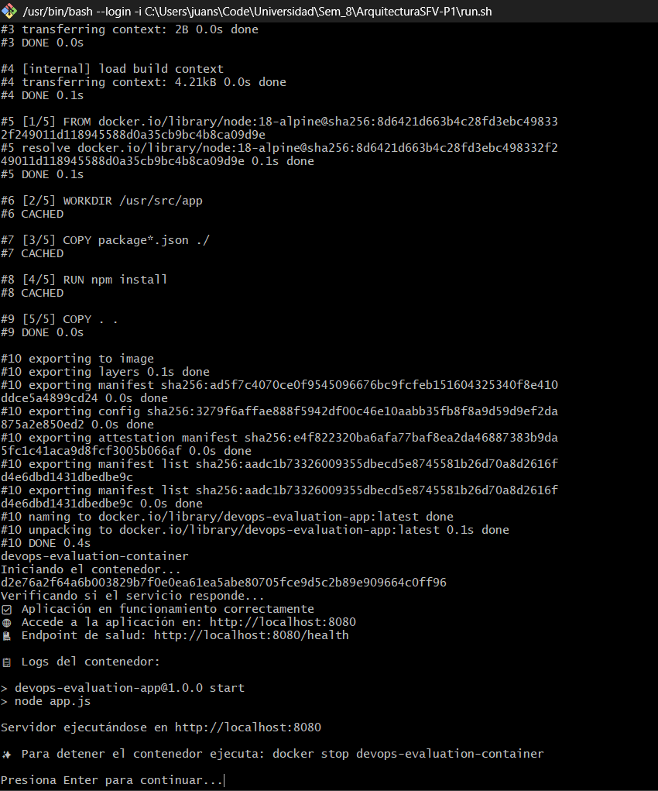

# ArquitecturaSFV-P1

# Evaluación Práctica - Ingeniería de Software V

## Información del Estudiante
- **Nombre: Juan Sebastian Gonzalez**
- **Código: A00371810**
- **Fecha: 06/08/2025**

## Resumen de la Solución
Se ha contenerizado una aplicación Node.js usando Docker y se automatizó todo el proceso de construcción, despliegue y verificación mediante un script bash. La solución sigue principios de DevOps como integración continua, automatización y consistencia de entornos.


## Dockerfile
Se construyó el `Dockerfile` utilizando la imagen oficial `node:18-alpine` por su ligereza. Se definió el directorio de trabajo, se copiaron los archivos necesarios, se instalaron dependencias, se definió la variable de entorno `NODE_ENV` y se expuso el puerto 8080. El comando final ejecuta la aplicación usando `npm start`.


## Script de Automatización
El script `run.sh` realiza las siguientes acciones:
1. Verifica si Docker está instalado.
2. Construye la imagen Docker.
3. Ejecuta el contenedor con las variables de entorno necesarias.
4. Realiza una verificación usando `curl` al endpoint `/health`.
5. Imprime el resultado de la operación (`éxito` o `error`).

## Principios DevOps Aplicados
1. **Automatización:** El script bash automatiza tareas de despliegue y pruebas.
2. **Consistencia de Entornos:** Docker garantiza que la aplicación se ejecute de forma idéntica en cualquier máquina.
3. **Feedback Rápido:** La prueba con `curl` permite detectar rápidamente si la app está funcionando correctamente.


## Captura de Pantalla


## Mejoras Futuras
1. Integrar pruebas automatizadas con `Jest` o `Mocha`.
2. Agregar un pipeline CI/CD con GitHub Actions.
3. Implementar monitoreo con Prometheus y Grafana en el contenedor.

## Instrucciones para Ejecutar
```bash
git clone https://github.com/tu_usuario/ArquitecturaSFV-P1.git
cd ArquitecturaSFV-P1
```

ejecuta despues:

```bash
./run.sh
```